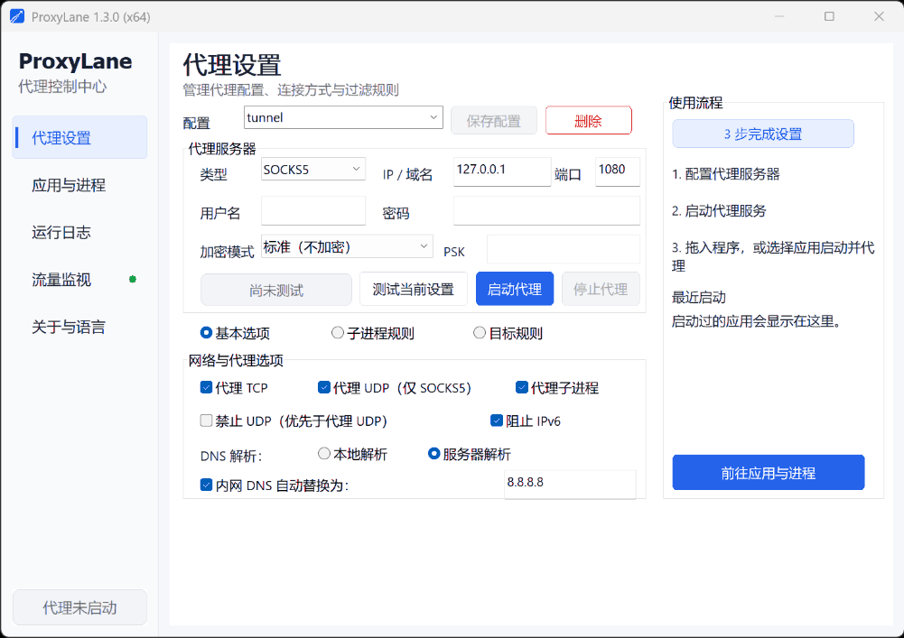

<h1 align="center">ProxyLane</h1>

<p align="center">
  <strong>Transparent per-process proxy for Windows · HTTPS / QUIC traffic decryption</strong><br>
  No TUN required · Separate proxy settings · Automatic child-process inheritance · Traffic recording and offline playback
</p>

<p align="center">
  Join the community discussion on <a href="https://linux.do/t/topic/2980923">Linux.do</a> and <a href="https://v2ex.com/t/1242151">V2EX</a>
</p>

<p align="center"><a href="README.md">简体中文</a> | English</p>

---

ProxyLane is an application-level transparent proxy for Windows. It uses process injection and network API hooks to route selected applications through a separately configured proxy without changing the system-wide proxy settings.

**Inspect encrypted application traffic:** decrypt HTTPS and QUIC v1, view HTTP/1.1, HTTP/2 and HTTP/3 requests, responses and bodies, and record, filter and replay sessions by process. Select `NOPROXY` to monitor and decrypt traffic without an external proxy.

Decryption requires the **64-bit host**, enabling the relevant options and installing a local CA. See [Traffic Monitoring and Decryption](#traffic-monitoring-and-decryption) for setup and application compatibility.

## Usage Demo



## Use Case

### Proxy a Command-Line Workspace

First, start the proxy with **Proxy child processes** enabled. Open a Command Prompt, select the new `cmd.exe` entry under **Apps and Processes**, and click **Proxy Selected**. Programs launched from that command-line window—including `curl`, Git, Python, `pip`, package managers, and other tools—will automatically inherit the active proxy settings. You do not need to add every child process separately or change the system-wide proxy.

For example:

```bat
curl https://example.com
git clone https://github.com/example/project.git
pip install requests
python script.py
```

## Features

- Transparent proxying for selected applications and processes
- HTTPS and QUIC v1 decryption with HTTP/1.1, HTTP/2 and HTTP/3 request, response and body inspection (64-bit host)
- Network sessions by process, DNS queries and responses, and Raw/Hex inspection
- Traffic recording and offline playback for troubleshooting and analysis
- Proxy profile management and connection testing
- HTTP and SOCKS5 support for TCP and UDP traffic
- Child-process and destination filtering rules
- Launch and proxy applications by dropping programs or shortcuts into the window
- Runtime logs and connection traffic statistics
- Win32 and x64 builds
- Compatible with Windows XP through Windows 11

## How It Works

ProxyLane uses user-mode process injection and API hooking to intercept and redirect application network connections. It does not install a kernel driver or modify the system-wide proxy settings.

- A Hook module matching the target process architecture is injected into a user-selected process. It intercepts network APIs and redirects matching TCP and UDP connections through the configured proxy.
- The Hook monitors process creation. When **Proxy child processes** is enabled, every injected process continues monitoring its descendants, allowing ProxyLane to handle multiple generations of child processes according to the configured filters.
- For a child process that must be proxied, the Hook module is loaded and initialized in that process's main-thread context. The main thread resumes only after initialization succeeds, ensuring the network hooks are ready before the application opens connections.
- The main application manages proxy profiles, filtering rules, and logs. The Hook module monitors child-process creation and network activity. The entire workflow runs in user mode.
- Win32 and x64 components are provided for compatibility with Windows XP through Windows 11.
- The 32-bit host and Windows XP / Server 2003 retain core proxy features without data monitoring, HTTPS decryption or gonc secure transport. A supported 64-bit host provides these features for both 32-bit and 64-bit target applications.

## Build Environment

- Visual Studio 2019
- Visual C++ v141_xp toolset
- Windows 7.1A SDK

Open `src/ProxyLane.sln`, select the `Win32` or `x64` platform, and build the solution. Release binaries are written to `bin/`.

### gonc TLS-PSK transport

For a SOCKS5 profile, select `gonc TLS-PSK` under **Transport** and enter the same PSK used by the remote gonc `:s5s` server. Both TCP and UDP use the encrypted SOCKS5 service directly; no local gonc client or standard SOCKS5 bridge is required.

PL's gonc TLS-PSK transport supports TLS 1.3 with TLS 1.2 compatibility. It does not send SNI, even when the proxy host is a domain name; authentication still checks the PSK-derived public key. Use `-tls13` on the gonc server to require TLS 1.3.

In this initial format, the PSK is stored as plaintext in the profile's `PSK=` field. Protect access to `ProxyLane.ini` accordingly. Secure transport is available only for SOCKS5, and plain HTTP/SOCKS5 profiles do not load the secure component.

Secure transport runs in the 64-bit host through `ProxyLaneSecureTransport64.dll` and supports both 32-bit and 64-bit target applications. The 32-bit host retains plain proxy support, without secure transport or data monitoring. The application and Hook DLLs remain built with `v141_xp`, and the secure DLL is not loaded unless the profile selects secure transport. Build them with the Rust MSVC toolchain:

```powershell
powershell -ExecutionPolicy Bypass -File .\scripts\build-secure-transport.ps1
```

## Sharing Proxy Profiles

Choose **Actions ▾ → Copy full profile** on the proxy settings page to copy the current settings, including unsaved edits, username, password, PSK, network options, child-process rules and target rules. The result is a single `proxylane://profile/v1/…` line. Base64URL is encoding, not encryption: anyone holding the code can read its credentials.

The recipient copies the complete line and chooses **Actions ▾ → Paste profile** to fill all profile fields. Imported profiles remain unsaved, and duplicate names receive an “(imported)” suffix. Existing unsaved edits prompt before replacement. While a proxy is running, pasted settings take effect only after **Save & Apply**. Global options, decryption settings, CA material, recordings and recent applications are not included.

Opening the profile dropdown refreshes its names from disk, including additions and deletions made by other instances. Selecting a profile reads its latest settings. Refreshing the list preserves current edits; a profile deleted by another instance is retained in the editor as an unsaved draft.

## Interface Languages

ProxyLane includes Simplified Chinese and English. By default, it follows the Windows UI language: Chinese systems use Simplified Chinese, while all other systems use English. You can also select a language on the **About & Language** page; the change takes effect the next time ProxyLane starts.

All translatable strings are stored in UTF-8 language catalogs:

- `src/ProxyLane/locales/zh-CN.json`
- `src/ProxyLane/locales/en-US.json`

Both catalogs must contain the same set of keys. `ProxyLane.rc` contains only control layout data, while the catalogs are embedded into the EXE as `RCDATA`, so release packages do not require external language files.

After changing translations, validate the catalogs and embedded resources with:

```powershell
powershell -ExecutionPolicy Bypass -File .\scripts\check-locales.ps1
```

## Traffic Monitoring and Decryption

The 64-bit host shows captured sessions by process without requiring applications to use the system proxy. Inspect HTTP/1.1 and HTTP/2 requests, responses and decompressed bodies, DNS queries and responses, and ordinary TCP/UDP traffic in Raw or HexView. HTTPS decryption is not restricted to port 443. QUIC v1 decryption is also independent of application name and port.

Under **Traffic Monitor → Decryption options**, enable HTTPS or QUIC decryption as needed (both default off), install the current-user CA when prompted, save, then start monitoring. Target applications need new connections. Stopping monitoring stops new interception and capture while existing connections keep forwarding. The QUIC option also attempts to relax compatible Chromium applications' extra restrictions on trusted local/enterprise CAs while retaining normal certificate validation. Restart target applications after changing this option; the compatibility change remains until they exit. Compatibility varies by browser version.

For monitoring without an external proxy, select `NOPROXY`, enable TCP/UDP interception as needed and disable **Block UDP**. Ordinary monitoring does not need a CA. Applications with private trust stores, certificate pinning or unsupported QUIC application protocols may not support decryption.

Enable QUIC decryption to automatically identify the negotiated application protocol; no ALPN entry is required. HTTP/3 keeps its request/response view, while other protocols expose decrypted bytes by Stream ID. QUIC DATAGRAMs appear separately with packet boundaries. Both support Raw/HexView and recording. QUIC v1 is supported; 0-RTT forwarding, migration, and HTTP/3 extensions such as WebTransport and CONNECT-UDP are not supported.

For long captures or analysis by an AI agent, enable **Keep recording files** under **Traffic Monitor → Options → Recording options**, choose a location, capacity and disk reserve, then start monitoring. The recording checkbox resets when ProxyLane restarts; the location and limits are remembered. Session metadata, request/response headers and payloads are saved continuously and retained after exit. Reaching capacity or running out of available disk space stops capture without deleting old payloads or interrupting existing connections.

After stopping monitoring, choose **Options → View saved recording…** and choose a recording directory to browse sessions, filter processes and inspect Raw/HexView again. Offline viewing requires no running proxy. Lists load from a saved index, with details read on demand. If the index is missing or damaged, ProxyLane asks before rebuilding it; original requests and payloads remain unchanged. The directory can also be passed directly to an AI agent and includes a format guide.

## Packaging a Release

Build the Win32 and x64 Release configurations, then run the following command from the repository root:

```powershell
powershell -ExecutionPolicy Bypass -File .\scripts\package-release.ps1
```

The script reads version information from the application and Hook binaries, verifies that they have the same version, and creates `dist/ProxyLane-version-Windows.zip`. The archive contains the Win32 and x64 applications, matching Hook DLLs, the 64-bit secure-transport and MITM DLLs, the sample configuration, a combined license file, and both README files. Test executables and command-line helpers are excluded.

The archive contains a single `LICENSE`: ProxyLane's own license appears first, followed by third-party licenses and notices under `Third-Party Software Licenses`.

The sample configuration is stored at `examples/ProxyLane.ini` and is copied to the package root as `ProxyLane.ini`.

“Test Current” uses `IPv6TestAddress` under `[options]` as its IPv6 egress probe address. It must be an IPv6 literal; the default is `2001:4860:4860::8888`, probed over TCP port 53.

Each profile can set `BlockIPv6=1` to prevent injected processes from reaching external IPv6 destinations. IPv4, IPv4-mapped IPv6, and local `::1` remain available. The “Block IPv6” UI option is off by default.

To use a custom output directory, add `-OutputDirectory D:\releases`.

## Project Structure

- `src/ProxyLane`: MFC desktop UI and application logic
- `src/ProxyLaneHook`: process injection and network Hook module
- `src/remotecode`: remote-code execution helper module
- `tests`: unit tests
- `examples`: sample configuration
- `scripts`: release packaging scripts
